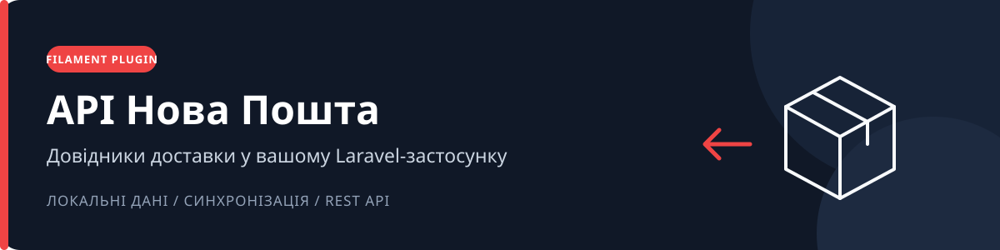
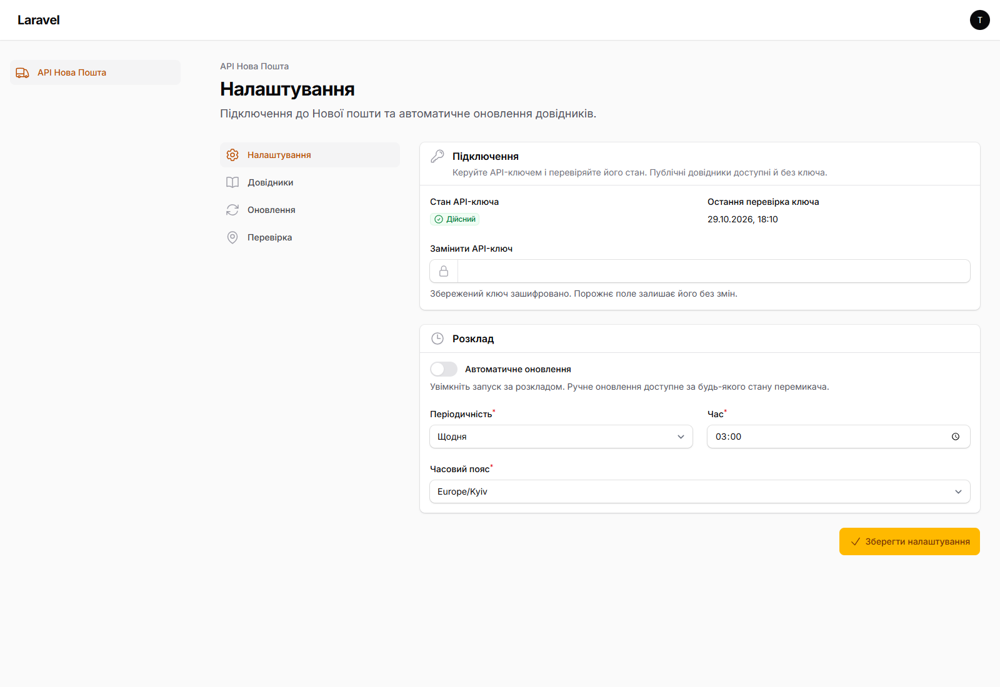
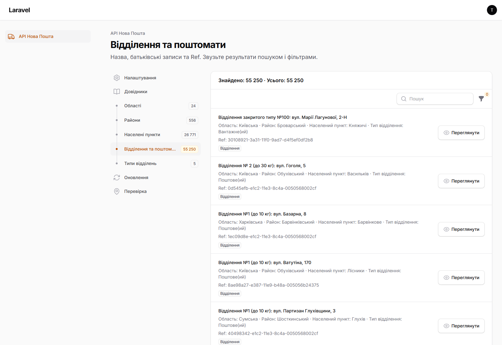
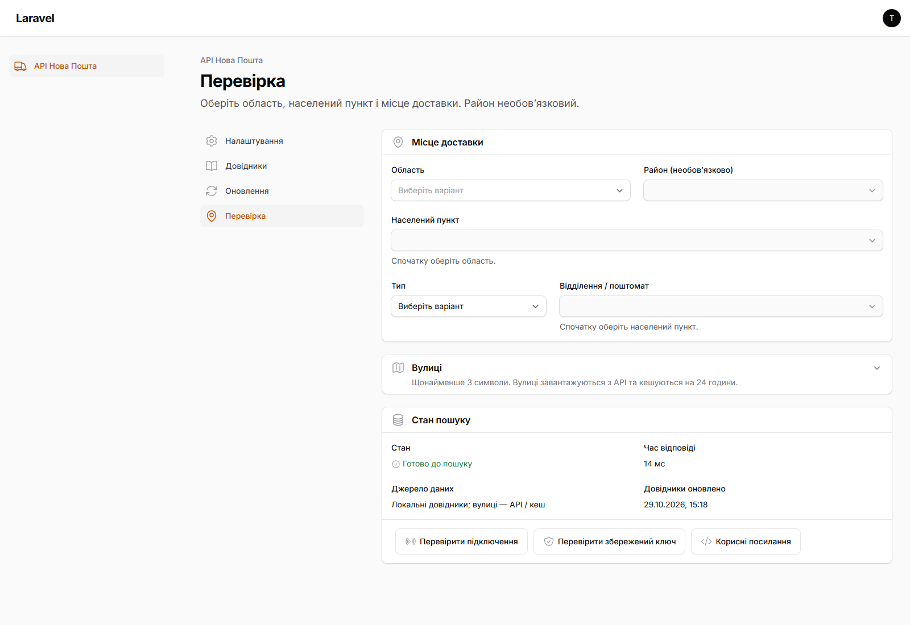

<p align="center">
  
</p>

<p align="center">
  <a href="https://www.php.net/"></a>
  <a href="https://laravel.com/docs"></a>
  <a href="https://filamentphp.com/docs/5.x"></a>
  <a href="https://livewire.laravel.com/"></a>
  <a href="LICENSE"></a>
</p>

<p align="center">
  
  
  
</p>

**Самостійний Composer-пакет для інтеграції довідників Нової пошти у Filament.** Зберігайте дані локально, оновлюйте їх у черзі та використовуйте спільний пошук через PHP, REST API й реактивний інтерфейс.

[Скриншоти](#скриншоти) · [Можливості](#можливості) · [Встановлення](#встановлення) · [Права доступу](#права-доступу) · [REST API](#rest-api) · [PHP API](#php-api) · [Оновлення](#оновлення-та-розклад) · [Перевірки](#перевірки)

## Скриншоти

Інтерфейс плагіна у стандартній світлій темі Filament. Знімки зроблено в локальному стенді; кількість записів і дати залежать від останнього оновлення довідників.

### Налаштування

Стан підключення, заміна API-ключа та розклад автоматичного оновлення. Збережений ключ не відображається.



### Список відділень і поштоматів

Локальний довідник із пошуком, фільтрами та переглядом відомостей про місце доставки.



### Перевірка доставки

Вибір області, населеного пункту та місця доставки, стан пошуку й діагностичні дії.



## Можливості

- **Довідники доставки:** області, райони, населені пункти, типи відділень, відділення та поштомати.
- **Локальний пошук:** фільтри за областю, районом, населеним пунктом і типом доставки.
- **Безпечне оновлення:** атомарна публікація перевіреного покоління; у разі помилки попередні дані залишаються доступними.
- **Сторінки Filament:** налаштування, довідники лише для читання, журнал оновлень і перевірка доставки.
- **Реактивні поля:** область → необов’язковий район → населений пункт → відділення або поштомат.
- **Вулиці на запит:** кеш на 24 години та об’єднання однакових одночасних запитів.
- **Розклад:** кожні N годин, щодня, щотижня або щомісяця.
- **Захист ключа:** шифрування в БД та авторизація через Laravel Gates.
- **Мови інтерфейсу:** українська, російська, англійська; резервна — українська.

Поточний обсяг — адресні довідники й пошук. Створення ТТН, розрахунок вартості та відстеження відправлень до нього не входять.

## Сумісність

| Компонент | Підтримувані версії |
|---|---|
| PHP | `^8.3` |
| Laravel | `^12.0` або `^13.0` |
| Filament | `^5.11` |
| Livewire | `^4.0` |
| База даних | SQLite, MySQL, PostgreSQL |

Пакет використовує стандартні компоненти й тему Filament. Власна frontend-збірка та окремий демонстраційний застосунок не потрібні.

## Встановлення

Пакет доступний на [GitHub](https://github.com/khweb/novaposhta-filament). Публікації на Packagist ще немає, тому додайте VCS-репозиторій у Composer.

Для приватного репозиторію потрібен доступ до нього з вашого GitHub-акаунту та налаштована авторизація Git/Composer. GitHub-токен не є API-ключем Нової пошти й не зберігається в налаштуваннях плагіна.

### 1. Підключіть пакет через Composer

Додайте до `composer.json` **Laravel-застосунку** запис у `repositories`:

```json
{
  "repositories": [
    {
      "type": "vcs",
      "url": "https://github.com/khweb/novaposhta-filament"
    }
  ]
}
```

Якщо секція `repositories` уже існує, додайте запис до неї.

```shell
composer require nova-poshta/filament:dev-main
php artisan vendor:publish --tag=nova-poshta-config
```

Laravel автоматично підключає service provider пакета. Гілка `main` містить поточну версію розробки; тегований реліз ще не опубліковано.

<details>
<summary>Локальна розробка через path repository</summary>

Клонуйте пакет поруч із Laravel-застосунком:

```shell
git clone https://github.com/khweb/novaposhta-filament.git NovaPoshta-Filament
```

```text
projects/
├── your-laravel-app/
└── NovaPoshta-Filament/
```

Замість VCS-запису використовуйте:

```json
{
  "repositories": [
    {
      "type": "path",
      "url": "../NovaPoshta-Filament"
    }
  ]
}
```

</details>

### 2. Налаштуйте таблиці та чергу

До перших міграцій за потреби додайте в `.env`:

```dotenv
NOVA_POSHTA_TABLE_PREFIX=api_nova_poshta_
NOVA_POSHTA_QUEUE=nova-poshta
```

```shell
php artisan migrate
php artisan filament:assets
```

Префікс `api_` створить `api_areas`, `api_settlements`, `api_warehouses` тощо. Префікс з’єднання Laravel застосовується окремо: `host_` + `api_` → `host_api_areas`.

Дозволено 1–32 латинські символи, цифри й підкреслення; перший символ — літера або підкреслення. **Зміна префікса не перейменовує наявні таблиці:** потрібна окрема міграція перенесення. Для rollback залишайте початкове значення.

### 3. Зареєструйте плагін

У наявному `PanelProvider` додайте плагін до конфігурації панелі:

```php
use Filament\Panel;
use NovaPoshta\Filament\NovaPoshtaPlugin;

public function panel(Panel $panel): Panel
{
    return $panel
        // Решта налаштувань вашої панелі...
        ->plugin(NovaPoshtaPlugin::make());
}
```

### 4. Завантажте довідники

Налаштуйте [Gates](#права-доступу), запустіть [worker](#оновлення-та-розклад), відкрийте **API Нова Пошта → Оновлення** та натисніть **«Оновити зараз»**.

До першого успішного завантаження пошук повертає `503 directory_not_ready`.

## Права доступу

За замовчуванням адміністративний доступ закрито. Приклад для `AppServiceProvider::boot()`:

```php
use Illuminate\Support\Facades\Gate;

Gate::define('nova-poshta.view', fn ($user) => $user->is_admin);
Gate::define('nova-poshta.manage', fn ($user) => $user->is_admin);
Gate::define('nova-poshta.sync', fn ($user) => $user->is_admin);
Gate::define('nova-poshta.diagnose', fn ($user) => $user->is_admin);
```

Замініть `is_admin` правилом авторизації вашого застосунку.

| Gate | Призначення |
|---|---|
| `nova-poshta.view` | Базовий доступ до всіх сторінок |
| `nova-poshta.manage` | Налаштування |
| `nova-poshta.sync` | Ручне оновлення |
| `nova-poshta.diagnose` | Перевірка доставки, підключення та ключа |

Додатковий Gate не замінює базовий `view`. Перевірки виконуються на сервері під час запитів Livewire й виконання дій.

### API-ключ

Один спільний ключ зберігається для всього застосунку, включно з панелями й орендарями. Введіть його на сторінці налаштувань.

Ключ шифрується Laravel за допомогою `APP_KEY`, прихований під час серіалізації та не завантажується у стан Livewire. Поле дозволяє замінити ключ; порожнє значення залишає попередній. Під час перенесення БД зберігайте відповідний `APP_KEY`.

Довідники запитуються без ключа. Дія **«Перевірити підключення»** викликає `Address/getAreas`, а **«Перевірити збережений ключ»** — запит лише для читання `Counterparty/getCounterparties` із `Limit=1`. Дані контрагентів не зберігаються й не показуються.

Пакет не журналює тіла HTTP-запитів і сирі винятки. У сторонніх інструментах налагодження застосунку налаштуйте приховування секретних HTTP-даних.

## REST API

Базовий шлях — `/api/nova-poshta/v1`. Усі ендпоінти публічні та використовують **GET**. Налаштування й запуск оновлень через REST недоступні.

### Ендпоінти

| Метод | Шлях | Опис | Додаткові фільтри |
|---|---|---|---|
| `GET` | `/api/nova-poshta/v1/areas` | Територіальні області | — |
| `GET` | `/api/nova-poshta/v1/districts` | Райони | `area_ref` |
| `GET` | `/api/nova-poshta/v1/settlements` | Населені пункти | `area_ref`, `district_ref` |
| `GET` | `/api/nova-poshta/v1/warehouses` | Відділення й поштомати | `area_ref`, `district_ref`, `settlement_ref`, `type` |
| `GET` | `/api/nova-poshta/v1/warehouse-types` | Типи відділень | — |
| `GET` | `/api/nova-poshta/v1/streets` | Вулиці населеного пункту | Обов’язкові `settlement_ref` і `q` від 3 символів |

### Параметри запиту

| Параметр | Правила |
|---|---|
| `q` | Пошук за українською або російською назвою; до 100 символів |
| `page` | Номер сторінки від `1`; типове значення `1` |
| `per_page` | Від `1` до `100`; типове значення `20` |
| `area_ref` | Зовнішній `Ref` області |
| `district_ref` | Зовнішній `Ref` району |
| `settlement_ref` | Зовнішній `Ref` населеного пункту; обов’язковий для вулиць |
| `type` | Лише для відділень: `branch` або `parcel_locker` |

Фільтри застосовуються тільки до ендпоінтів із таблиці вище. Для вулиць населений пункт має існувати в активному поколінні даних.

### Приклади запитів

Пошук населених пунктів:

```shell
curl --get "https://your-app.example/api/nova-poshta/v1/settlements" \
  --data-urlencode "q=Біла" \
  --data-urlencode "per_page=20"
```

Поштомати обраного населеного пункту:

```shell
curl --get "https://your-app.example/api/nova-poshta/v1/warehouses" \
  --data-urlencode "settlement_ref=SETTLEMENT_REF" \
  --data-urlencode "type=parcel_locker"
```

Пошук вулиці:

```shell
curl --get "https://your-app.example/api/nova-poshta/v1/streets" \
  --data-urlencode "settlement_ref=SETTLEMENT_REF" \
  --data-urlencode "q=Шев"
```

Замініть домен адресою застосунку, а `SETTLEMENT_REF` — значенням із відповіді `/settlements`.

### Формат відповіді

Скорочений приклад:

```json
{
  "data": [
    {
      "ref": "external-ref",
      "name": "Назва",
      "name_ru": "Название"
    }
  ],
  "meta": {
    "current_page": 1,
    "per_page": 20,
    "total": 1,
    "last_page": 1
  },
  "links": {
    "first": "...?page=1",
    "last": "...?page=1",
    "prev": null,
    "next": null
  }
}
```

Локальні довідники повертають `ref`, `name`, `name_ru`, `area_ref`, `district_ref`, `settlement_ref`, `city_ref`, `type_ref`, `type`, `address`, `latitude`, `longitude`, `schedule`, `limits`. Необов’язкові поля можуть мати значення `null`; `limits` містить наявні обмеження доставки й може бути порожнім масивом.

Для вулиць повертаються `ref` (`SettlementStreetRef`), `name` (`Present`), `name_ru` та `settlement_ref`. Сортування стабільне: назва, потім `Ref`. Внутрішні числові ID не входять до публічного контракту.

### Помилки та ліміти

| HTTP | Значення |
|---|---|
| `422` | Некоректні параметри або невідомий населений пункт для вулиць |
| `429` | Перевищено ліміт запитів |
| `503` + `directory_not_ready` | Ще немає опублікованого покоління довідників |
| `503` + безпечний код помилки | Зовнішній пошук вулиць недоступний або повернув некоректні дані |

```json
{"error": "directory_not_ready"}
```

Загальний ліміт REST — **60 запитів/хв на IP**; для вулиць додатково — **10 запитів/хв на IP**. Загальний ліміт зовнішніх звернень за замовчуванням — **120 запитів/хв на застосунок**. Налаштуйте trusted proxies для правильного визначення IP.

### Налаштування маршрутів

У `config/nova-poshta.php`:

```php
'rest' => [
    'enabled' => true,
    'prefix' => 'api/nova-poshta/v1',
    'middleware' => ['api'],
],
```

REST можна вимкнути через `NOVA_POSHTA_REST_ENABLED=false`. Після змін перебудуйте кеш конфігурації та маршрутів. Група middleware `api`, CORS і додаткова автентифікація налаштовуються в застосунку.

## PHP API

PHP-споживачі, REST і сторінки Filament використовують спільний сервіс пошуку:

```php
use NovaPoshta\Filament\Services\DirectorySearch;
use NovaPoshta\Filament\Services\SyncCoordinator;

$search = app(DirectorySearch::class);

$areas = $search->search('areas', ['q' => 'Київ']);

$settlements = $search->search('settlements', [
    'area_ref' => $areaRef,
    'q' => 'Біла',
    'page' => 1,
    'per_page' => 20,
]);

$warehouses = $search->search('warehouses', [
    'settlement_ref' => $settlementRef,
    'type' => 'parcel_locker',
]);

$streets = $search->search('streets', [
    'settlement_ref' => $settlementRef,
    'q' => 'Шев',
]);

$run = app(SyncCoordinator::class)->request();
```

`search()` повертає `LengthAwarePaginator` із масивами записів і використовує одне активне покоління на весь пошук.

Для кількох узгоджених запитів отримайте `$generation = $search->snapshot()` і передавайте його в `$search->query($directory, $filters, $generation)`. Метод повертає Eloquent Builder і не застосовується до вулиць.

PHP-сервіси призначені для довіреного серверного коду: застосунок перевіряє права свого користувача самостійно. Filament виконує ці перевірки через Gates.

## Оновлення та розклад

Автооновлення спочатку вимкнене. Запропоновані значення — щодня о **03:00**, часовий пояс **Europe/Kyiv**.

| Режим | Поведінка |
|---|---|
| Кожні N годин | Від останнього автоматичного запуску |
| Щодня | У вибрану хвилину місцевого часу |
| Щотижня | У вибраний день; `1` — понеділок, `7` — неділя |
| Щомісяця | У вибраний день; за його відсутності — останнього дня місяця |

Пропущена календарна хвилина не надолужується. Якщо під час переходу на зимовий час година повторюється, завдання запускається не більш ніж один раз за місцеву дату.

### Scheduler

```cron
* * * * * cd /path/to/app && php artisan schedule:run >> /dev/null 2>&1
```

Пакет сам реєструє щохвилинну перевірку розкладу.

### Queue worker

```shell
php artisan queue:work --queue=nova-poshta --timeout=120 --tries=1
```

Використовуйте асинхронне з’єднання черги, наприклад `database` або `redis`, та створіть відповідну інфраструктуру. `QUEUE_CONNECTION=sync` виконає оновлення всередині HTTP-запиту. Для постійної роботи керуйте worker через Supervisor або systemd.

`retry_after` має перевищувати `sync.timeout` — за замовчуванням `120` секунд; рекомендовано `180` або більше. Якщо конфігурація вже опублікована, змініть старе значення `sync.timeout=7200` на `120` та перезапустіть worker через `php artisan queue:restart`. Для web-процесів і worker потрібне спільне сховище кешу з атомарними блокуваннями; для кількох серверів — Redis або спільний database cache. Драйвер `array` призначений для тестів.

### Синхронізація

1. Ручний та автоматичний запуск отримують спільне блокування.
2. Довідники посторінково записуються в нове покоління.
3. Перевіряються повнота, повтори сторінок і зв’язки.
4. Активне покоління перемикається атомарно.

Ручний запуск ігнорує розклад; повторне натискання **«Оновити зараз»** повертає активне завдання. У разі збою попередні дані залишаються доступними.

**Живий звіт.** Після запуску відкривається окрема сторінка звіту: прогрес етапів, кількості записів за довідниками, тривалість, запити довідників, помилки, повтори, попередження та стан ключа. Історія компактна; натискання запису відкриває його повний журнал. Під час роботи звіт оновлюється кожні 2 секунди. Закриття браузера не зупиняє чергу.

API може повідомляти недостовірний `totalCount`, тому прогрес показує завершені етапи, сторінки та фактичні кількості без вигаданого відсотка. `100%` з’являється лише після перевірки й атомарної публікації.

**Журнал за 7 днів.** Події містять зрозумілий опис отримання, перевірки й збереження сторінок, повторів, помилок і публікації. Технічні подробиці розгортаються окремо. На екрані не більше 50 подій; попередні й наступні доступні кнопками. Прокручування вгору призупиняє стеження; кнопка «Останні події» його відновлює. Немає експорту чи зовнішніх сповіщень. Щогодинне очищення видаляє завершені запуски та їхні події старші за 7 днів, зберігаючи активні запуски, довідники й дату останньої успішної синхронізації.

**Відновлення.** Кожна сторінка API та частина перевірки виконуються окремим ідемпотентним завданням. Записи й контрольна точка фіксуються однією транзакцією; повторна доставка не дублює записи чи лічильники. Тимчасові мережеві помилки, `429` і `5xx` отримують до 3 спроб із відкладеним запуском, збільшенням затримки та випадковим зміщенням. `Retry-After` враховується в межах 600 секунд. Зовнішній ліміт відкладає завдання, звільняючи worker. Лічильник помилок включає помилки, після яких повтор допоміг; вони не змінюють успішний підсумковий статус на помилку. Попередження ключа рахуються окремо від повторів.

Scheduler відновлює втрачений запуск наступного кроку або перерваний worker за збереженою контрольною точкою. Heartbeat, старший за `900` секунд, позначається остаточною помилкою навіть із вимкненим автооновленням. Після остаточного збою звіт пояснює причину й пропонує «Запустити заново»: створюється новий повний запуск, попередні опубліковані дані залишаються доступними. Діагностика окремо показує останні звернення scheduler, worker та API.

**Стан ключа.** Заміна ключа ставить перевірку в чергу; на початку синхронізації перевірка повторюється. Використовується тільки `Counterparty/getCounterparties` із `Limit=1`, без збереження даних контрагентів. Стани: ще не перевірено, відсутній, дійсний, відхилений або перевірка недоступна. Таймаут не вважається простроченням. Попередження показується біля запису синхронізації та у звіті; публічні довідники завантажуються незалежно від ключа. Пізня відповідь для старого ключа не перезаписує стан нового. Точна дата завершення дії ключа не визначається.

Для оновлення наявного встановлення виконайте `php artisan migrate`: нова міграція зберігає довідники, налаштування та переносить дату останньої публікації. Старі запуски мають тільки раніше збережений підсумок — докладні події створюються для нових запусків.

## Дані та ідентифікатори

| Значення | Простір ідентифікаторів |
|---|---|
| `getAreas.Ref`, `getCities.Area` | Області компанії |
| `getSettlements.Area` | Територіальні області |
| `getCities.Ref`, `getWarehouses.CityRef` | Міста компанії |
| `getSettlements.Ref`, `getWarehouses.SettlementRef` | Населені пункти |

**Не передавайте `CityRef` замість `SettlementRef`.** `/areas` повертає територіальні області, узгоджені з фільтрами населених пунктів. Обидва простори областей зберігаються з типами `company` та `territorial`.

Райони формуються з `Region`, а явні пари міст і населених пунктів — із даних відділень у `city_mappings`. Вихідні дані зберігаються в JSON `payload`, включно з назвами, координатами, графіками й обмеженнями.

Старі покоління автоматично не видаляються, щоб не переривати вже розпочаті пошуки. За потреби налаштуйте обслуговування з достатнім строком зберігання, виключаючи активні та незавершені покоління. Видалення активного покоління обмежене зовнішнім ключем.

Вулиці кешуються на 24 години. Прострочені записи не використовуються; фізичне очищення кешу можна додати до обслуговування застосунку.

## Перевірки

Автоматичні запуски GitHub Actions на `push` і `pull_request` тимчасово вимкнено на запит власника. Тести збережено: їх можна запустити вручну через **Actions → tests → Run workflow** або локально командами нижче.

```shell
composer install
composer test
composer lint
composer validate --strict
```

Orchestra Testbench піднімає Laravel усередині тестів. У тестах використовуються HTTP fixtures із `tests/Fixtures`; довільні мережеві запити заборонені.

Поточний набір містить **71 тест**; останній локальний прогін на Laravel 13 і SQLite — **527 тверджень**. Попередні прогони охоплювали Laravel 12/13, SQLite, MySQL і PostgreSQL; окремий інтеграційний тест запускає справжній database queue worker і перевіряє `failed_jobs`. Точні прогони та обмеження наведено у [звіті перевірки](docs/verification.md). [Workflow CI](.github/workflows/tests.yml) також містить PHP 8.3/8.4.

Для MySQL/PostgreSQL доступні `NP_TEST_DB_DRIVER`, `NP_TEST_DB_PORT`, `NP_TEST_DB_DATABASE`, `NP_TEST_DB_PASSWORD`. Використовуйте окрему базу `nova_poshta_test*`: тестовий bootstrap очищає її перед кожним тестом. За замовчуванням використовується SQLite у пам’яті.

### Перегляд у браузері

```shell
php -S 127.0.0.1:8824 tests/Browser/router.php
```

Відкрийте `http://127.0.0.1:8824/admin/nova-poshta/tester`. За замовчуванням стенд звертається до реального API й зберігає дані між запитами. Для завантаження та перевірки ключа запустіть окремий процес:

```shell
php tests/Browser/console.php work
```

Запускайте оновлення на сторінці **«Оновлення»** або командою `php tests/Browser/console.php sync`. Команда `php tests/Browser/console.php status` показує безпечний стан без ключа. Збереження ключа ставить у чергу його перевірку; завантаження довідників запускається окремо.

Це локальний стенд із тестовою авторизацією та тестовим ключем шифрування: запускайте лише на loopback. Web і worker використовують одну SQLite-базу й спільний файловий кеш. Для UI fixtures передайте `X-Nova-Poshta-Scenario: completed|running|queued|failed`; ці сценарії мають окремі бази. PHPUnit-тести залишаються без мережі. Докладно: [синхронізація відділень](docs/warehouse-sync.md).

## Документація та участь у розробці

- [Правила внесення змін](CONTRIBUTING.md)
- [Історія змін](CHANGELOG.md)
- [Повідомлення про вразливості](SECURITY.md)
- [План реалізації](docs/implementation-plan.md)
- [Звіт перевірки](docs/verification.md)

## Джерела

- [Офіційна документація API Нової пошти](https://developers.novaposhta.ua/documentation)
- [Публічний JSON endpoint](https://api.novaposhta.ua/v2.0/json/)
- [Документація Filament 5](https://filamentphp.com/docs/5.x/plugins/panel-plugins)
- [daaner/NovaPoshta: особливості адресного API](https://github.com/daaner/NovaPoshta/blob/master/src/Models/Address.php)

Документація Нової пошти під час дослідження повернула `403`; форми відповідей додатково перевірено публічними POST-запитами 28.10.2026. Обов’язкової залежності від стороннього SDK немає.

## Ліцензія

[MIT](LICENSE).
